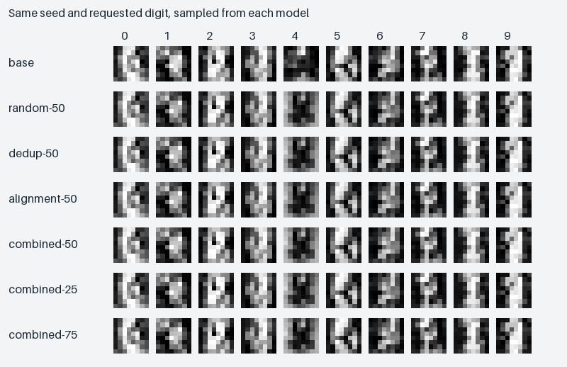

# Fixed-budget training data mixtures

Six data curation policies fine-tune copies of the same conditional diffusion model on labelled handwritten digits. The experiment isolates filtering and mixture effects because every adapter sees 120 records, 72 optimizer updates, the same noise schedule and the same training seed. The available captions describe the digit and foreground polarity. This controlled data study provides evidence for the 8×8 digit task.



In the published run, combined 50/50 filtering reduced injected caption errors from **38/120 to 5/120** compared with random selection and retained 120 distinct image groups. It did not improve digit generation: the independent judge recognized **8/80** requested digits after combined filtering and **10/80** after random selection. Its accuracy on the 217 real held-out digits was **98.2%**. Across the three combined mixtures joint accuracy ranged from 6.25% to 7.5%. These results show a measurable curation benefit and weak digit conditioning at this training budget.

```shell
python -m venv .venv
# PowerShell: .\.venv\Scripts\Activate.ps1
# Bash: source .venv/bin/activate
python -m pip install -r requirements.txt
python run.py demo --out work/demo
```

The demo loads the bundled base and joint-filter LoRA from disk and generates a new digit strip on CPU. No account, hosted model or paid GPU is required.

## Experiment

1. Split 1,797 real UCI digit images by source image into five disjoint roles: 480 clean base-training records, 250 for an alignment filter, 250 for an independent digit judge, 600 potential adaptation sources and 217 held-out real images. The split is stratified by true digit. The packaged source lacks writer IDs, so no writer-disjoint result is claimed.
2. Form two rendering domains, light ink on dark and dark ink on light. Each source receives a class-based caption. Some caption digits are deliberately flipped; selected sources also get a gain-adjusted image to create controlled near-duplicates. The original source label is used for auditing and the two disjoint judges. It is not fed to curation as the label for an individual pool image.
3. Compare random selection, binary-image signature deduplication, image/caption-score filtering, and combined filtering at a 50/50 polarity mix. The combined filter also runs at 25% and 75% dark-on-light. The task-specific alignment score is the probability of the caption's digit under a disjoint 9-nearest-neighbour classifier. DataComp's inclusive score-threshold selection is retained, then sampled to an exact budget. Near-duplicate grouping targets the deliberately injected gain variants.
4. Train a small Diffusers conditional U-Net base on the 480 clean examples for 220 steps. Train one rank-4 attention LoRA per selection. All adapters start from the same model and initialization. Reload each trained adapter into a fresh model before measuring anything. Generate 80 samples per model (10 digits, 2 polarities, 4 seed indices), sharing each starting noise tensor across all arms. Separately evaluate matched-noise denoising MSE on all 217 held-out source images.
5. Score generated digit identity using an independently trained SVM, and score polarity from border luminance. Report digit accuracy, polarity accuracy, joint accuracy and held-out denoising MSE. With four generated samples per prompt, small accuracy differences are exploratory.

```shell
python -m unittest discover -s tests -v
python run.py reproduce --out work/full
python run.py evaluate --run work/full --out work/rebuilt
python run.py evaluate --out work/from-published-predictions
```

**Implementation.** `src/curation.py` creates source splits, perturbations and budget-matched data pools. `src/diffusion.py` uses Diffusers' conditional U-Net, DDPM training and DDIM sampling. `src/sd.py` applies, saves and reloads PEFT attention adapters. `src/report.py` uses saved per-image predictions and samples to rebuild the CSV and comparison image. `configs/experiment.json` freezes training, selection and generation budgets.

**Artifacts.** The published run includes [the summary table](results/summary.csv), [selected records, sources and captions](results/selection.json), [dataset split](results/split.json), [training losses and adapter update norms](results/training.json), [per-sample predictions and held-out errors](results/predictions.json), exact generated arrays and the reloadable weights in `results/weights/`. See [attribution and data terms](UPSTREAM.md) and [the next reproduction step](HANDOFF.md).
